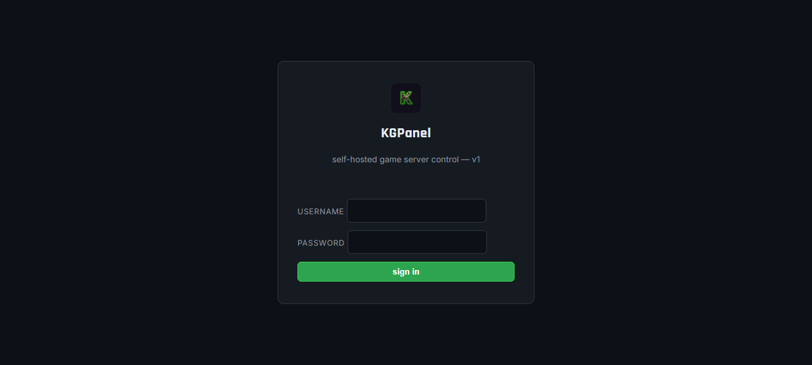
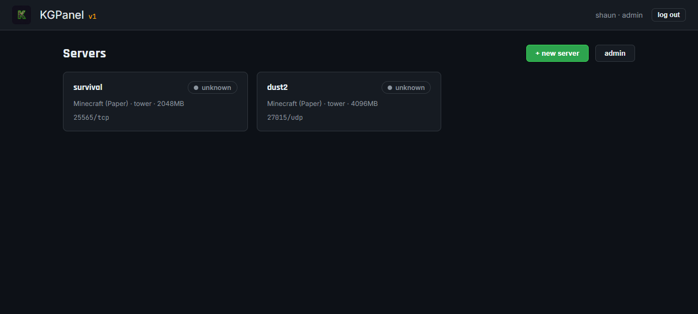
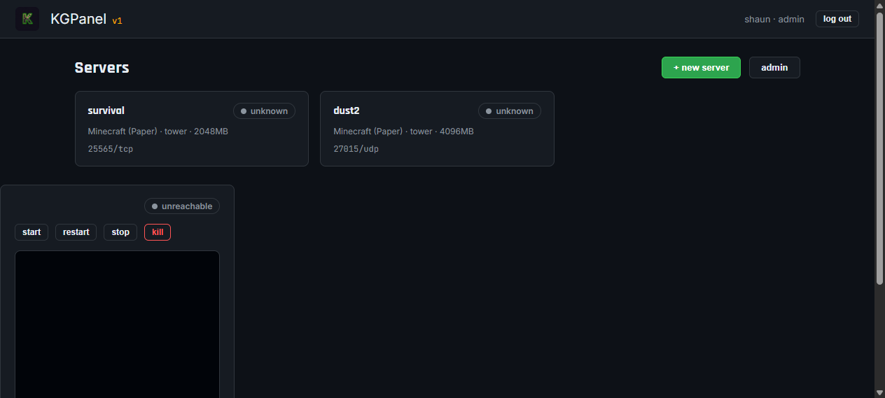
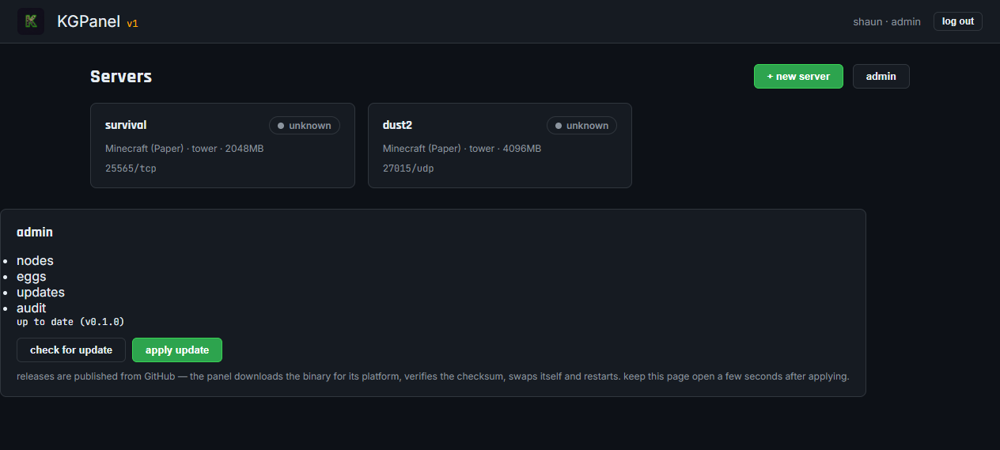

# KGPanel v1

Self-hosted game server management — **panel + wings** — written from scratch in Go.
A clean-room re-implementation of the panel/daemon architecture (Pelican/Pterodactyl class),
**not a fork**: no AGPL code is copied (wings-style daemon design is MIT-compatible; ours is
original code under MIT).

Runs on **Docker**, **bare Linux**, and **Windows (native .exe)**. One static binary per component.

```
┌─────────────┐   HTTP/WS    ┌─────────────┐   Docker API   ┌──────────────┐
│   PANEL     │ ───────────► │    WINGS    │ ─────────────► │  game server │
│  web UI +   │              │  node agent │   (container   │  containers  │
│  API + auth │ ◄─────────── │  power/fs/  │    lifecycle)  │  (isolated)  │
└─────────────┘              │  console    │                └──────────────┘
```

## Download

Grab prebuilt binaries for Linux (amd64/arm64) and Windows (native `.exe`) from
the **[Releases](https://github.com/MrKnuckls/kgpanel/releases)** page — or build
from source (`make build`).

## Install

**Step-by-step guide (like your favorite panel's docs): [`docs/INSTALL.md`](docs/INSTALL.md)**

Covers: requirements → download → panel install (binary + systemd, or Docker
Compose) → first-run admin setup → wings install (Linux + Windows) → adding
eggs → deploying a first server → **domain + free SSL via Cloudflare (one-command
scripts for Linux/macOS/WSL *and* native Windows)** → securing, backups,
troubleshooting.

No database, no PHP, no Redis — just one binary and a JSON data directory.

## Domain + SSL in one command

Point a domain at your panel without touching your router, certs, or firewall:

```bash
# Linux / macOS / WSL
bash <(curl -fsSL https://raw.githubusercontent.com/MrKnuckls/kgpanel/main/deploy/kgpanel-cloudflare.sh) \
  --domain panel.example.com --cf-token "$CF_TOKEN" --cf-account YOUR_ACCOUNT_ID
```

```powershell
# Windows — no WSL needed
powershell -ExecutionPolicy Bypass -File deploy\kgpanel-cloudflare.ps1 `
  -Domain panel.example.com -CfToken $env:CF_TOKEN -CfAccount YOUR_ACCOUNT_ID
```

Creates the Cloudflare Tunnel, DNS record (proxied), ingress, optional
email-gate, and a boot-start cloudflared service — SSL served automatically.

## Screenshots

| Sign in | Dashboard |
|---|---|
|  |  |

| Server detail (power + console) | Admin → updates (self-update) |
|---|---|
|  |  |

## Quick start (Docker)

```bash
docker compose up -d          # panel on :8080, wings on :8081
```

First run: open the panel, complete the one-time **setup** page (creates the admin
account), then register your node (wings address + its token).

## Quick start (bare Linux)

```bash
# panel
./kgpanel --listen :8080 --data /var/lib/kgpanel --secret <random>

# wings (on each game node)
./wings --listen :8081 --token <shared-secret> --data /var/lib/wings
```

## What v1 does

- **Panel** — user auth (bcrypt + HMAC-signed tokens), server CRUD, node management,
  egg (server template) management, power control, live console streaming, audit log.
- **Wings** — runs on each game node, talks to Docker (via the CLI, no daemon-in-daemon),
  starts/stops/restarts/kills containers, streams container logs, reports real state.
- **Eggs** — declarative JSON server templates (image, startup command, stop command,
  variables, ports). Drop one in and you can deploy that game.
- **Status is evidence-based** — panel asks wings for the container's real state; it
  never trusts a regex against empty stdout. A live server never shows OFFLINE.
- **Branding** — knuckls palette + logo, GitHub-dark look (see `panel/web/`).

## Layout

```
panel/     Go web panel (API + embedded UI)        → kgpanel binary
wings/     Go node agent (Docker lifecycle)         → wings binary
eggs/      JSON server templates (one per game)
deploy/    Dockerfiles (multi-stage)
docs/      architecture & API notes
```

## Roadmap (post-v1)

- File manager (SFTP-style, like wings' `/api/client/servers/{id}/files`)
- Backups (compress + rotate), install scripts per egg, scheduler
- Postgres/SQLite backend behind the storage interface (v1 uses JSON files)
- Multi-node dashboard with per-node resource graphs (sparklines)

## License

MIT — original code. Not derived from Pelican or Pterodactyl.
