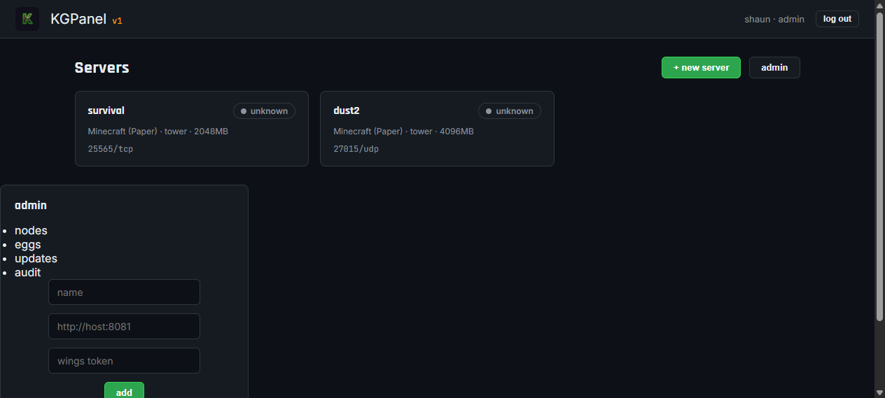

# Installing KGPanel

KGPanel is a self-hosted game server management panel. It ships as two small
static binaries — **panel** (web UI + API) and **wings** (node agent that runs
on each game server box) — plus a Docker Compose option.

This guide walks you through installing both, first-run setup, and deploying
your first game server. It follows the same shape as the panel-host docs you
may know (Pterodactyl/Pelican style), but KGPanel has **no database, no PHP,
no Redis** — data lives in plain JSON files and everything is a single Go
binary, so there is far less to break.

Here's what the panel looks like. (Screenshots are from the dev build with
sample data — your install will look the same.)

| Sign in | Dashboard |
|---|---|
|  |  |

| Server detail (power + console) | Admin → nodes |
|---|---|
|  |  |

| Admin → updates (self-update) |
|---|
|  |

---

## 1. Requirements

### Panel host

| Requirement | Minimum |
|---|---|
| OS | Linux (x86_64 or arm64), or Windows 10/11 |
| RAM | 512 MB |
| Disk | 200 MB |
| Ports | **8080** (panel web UI) |
| Docker | optional (only if using Docker Compose) |

### Wings node (the box running game servers)

| Requirement | Minimum |
|---|---|
| OS | Linux (x86_64/arm64) or Windows with Docker Desktop |
| RAM | 2 GB + whatever your games need |
| Ports | **8081** (wings API, panel → wings) + the game ports themselves |
| Docker | **Docker Engine required** (or Docker Desktop on Windows) |
| docker CLI | required — wings drives the daemon through the `docker` CLI |

> Each game server runs in its own container with a memory + CPU cap, so one
> node can host many servers without them interfering.

---

## 2. Download

Grab the latest binaries from the **Releases** page on GitHub:

- `kgpanel-linux-amd64` / `kgpanel-linux-arm64` — panel for Linux
- `kgpanel-windows-amd64.exe` — panel for Windows
- `wings-linux-amd64` / `wings-linux-arm64` — wings for Linux
- `wings-windows-amd64.exe` — wings for Windows

Or build from source:

```bash
git clone https://github.com/MrKnuckls/kgpanel.git
cd kgpanel
make build          # produces dist/kgpanel and dist/wings
```

---

## 3. Install the panel (Linux — binary)

```bash
# 1. move the binary into place
sudo install -m 0755 kgpanel-linux-amd64 /usr/local/bin/kgpanel

# 2. data directory (state lives here — back it up)
sudo mkdir -p /var/lib/kgpanel

# 3. generate a secret for signing login tokens — SAVE THIS
openssl rand -hex 32

# 4. run once to verify
sudo kgpanel --listen :8080 --data /var/lib/kgpanel --secret <the-secret-above>
```

Stop it (Ctrl+C) once you see `KGPanel listening on :8080`, then set it up as a
service with systemd:

```ini
# /etc/systemd/system/kgpanel.service
[Unit]
Description=KGPanel
After=network.target

[Service]
ExecStart=/usr/local/bin/kgpanel --listen :8080 --data /var/lib/kgpanel --secret YOUR_SECRET_HERE
Restart=always
RestartSec=5

[Install]
WantedBy=multi-user.target
```

```bash
sudo systemctl daemon-reload
sudo systemctl enable --now kgpanel
sudo systemctl status kgpanel
```

Your panel is now live at `http://<server-ip>:8080`.

---

## 4. Install the panel (Docker Compose)

```bash
# clone the repo
git clone https://github.com/MrKnuckls/kgpanel.git
cd kgpanel

# set your secrets
cp .env.example .env
#   KGPANEL_SECRET=<random hex 32>
#   KGWINGS_TOKEN=<random string>

docker compose up -d --build
```

The panel comes up on `:8080` and wings on `:8081` (both in one stack). Skip to
**Section 7 (first run)**.

---

## 5. First run — create your admin account

Open `http://<server-ip>:8080`. You'll see the sign-in page. Because no
accounts exist yet, **any username + a password of 8+ characters creates your
admin account on first login** — do this once, then use those credentials from
then on.

> The panel only accepts anonymous setup while it has **zero** users. After
> that, logins are verified normally.

Log out and sign back in to confirm. The profile chip in the top bar should
show `you · admin`.

---

## 6. Add a node (the box running your games)

In the panel:

1. Click **admin** (top right) → **nodes** tab
2. Enter:
   - **name** — anything, e.g. `tower`
   - **url** — `http://<wings-host>:8081`
   - **wings token** — the same `KGWINGS_TOKEN` value you set on wings
3. Click **add**

## 7. Install wings

### Linux

```bash
sudo install -m 0755 wings-linux-amd64 /usr/local/bin/wings
sudo mkdir -p /var/lib/wings
```

Systemd unit:

```ini
# /etc/systemd/system/wings.service
[Unit]
Description=KG Wings
After=docker.service
Requires=docker.service

[Service]
ExecStart=/usr/local/bin/wings --listen :8081 --token YOUR_WINGS_TOKEN --data /var/lib/wings
Restart=always
RestartSec=5

[Install]
WantedBy=multi-user.target
```

```bash
sudo systemctl daemon-reload
sudo systemctl enable --now wings
sudo systemctl status wings
```

### Windows

1. Install **Docker Desktop** and make sure the docker CLI is on your PATH
2. Create `C:\ProgramData\wings\` (or anywhere)
3. Run from a terminal:

```bat
wings-windows-amd64.exe --listen :8081 --token YOUR_WINGS_TOKEN --data C:\ProgramData\wings
```

Verify wings is up: `http://<wings-host>:8081/v1/health` should return
`{"status":"ok",...}`.

---

## 8. Add an egg (game template)

Eggs define how a game runs: docker image, startup command, stop command,
ports. Back in the panel admin → **eggs** tab:

1. **name** — e.g. `Minecraft (Paper)`
2. **docker image** — e.g. `ghcr.io/parkervcp/yolks:java_17` (any image that
   runs your game; for a first test `python:3.12-slim` works)
3. **startup** — e.g. `java -Xmx{{MEM}}M -jar server.jar`
4. **stop command** — what to send on graceful stop, e.g. `stop`
5. **ports** — comma separated, e.g. `25565/tcp`
6. **variables** — `{{VAR}}` names used in startup, e.g. `MEM,JAR`

Example eggs ship in the repo under `eggs/`.

---

## 9. Create your first server

1. On the dashboard click **+ new server**
2. Pick your egg and node, set memory (MB) + cpu %, and the ports the egg
   exposes
3. Click **create**

You'll see it in the grid. Open it:

- **power** buttons start/restart/stop/kill the container (kill is not in the
  UI on purpose — a hard kill should be deliberate)
- **console** streams the live container log; type a command and press Enter
  to send it to the server's stdin
- the status badge reports what wings actually observes on the container —
  a running game never shows OFFLINE because a log regex disagreed

---

## 10. Auto-updating (push an upgrade, all clients follow)

KGPanel ships with a **self-updater built in**. When you publish a new release
(with the exact tag format `v1.2.3`), every installed panel and wings can
update **itself** — no SSH, no re-downloading, no manual binary swap.

How it works:

1. You tag a release → GitHub Actions builds all 6 platform binaries, generates
   `checksums.txt` (sha256 per binary) and publishes the release.
2. Each panel/wings checks the release feed (`/api/update/check` on panel,
   `/v1/update/check` on wings) — by default GitHub's latest release, or a
   custom feed via `--update-url` / `KGPANEL_UPDATE_URL` / `KGWINGS_UPDATE_URL`.
3. If a newer version exists, it downloads the binary **matching its own
   platform** (panel on Windows fetches `kgpanel-windows-amd64.exe`, etc),
   verifies the sha256 against `checksums.txt`, swaps the running binary, and
   restarts itself.

### In the UI

admin → **updates** tab → *check for update* / *apply update*. The panel tells
you what version it found and swaps itself with one click.

### From the CLI

```bash
# panel
curl -X POST http://localhost:8080/api/update -H "Authorization: Bearer <token>"

# wings
curl -X POST http://localhost:8081/v1/update -H "X-KG-Token: <wings-token>"
```

### Publishing a release

```bash
git tag v0.2.0 && git push origin v0.2.0
```

That's it — Actions builds, checksums, and attaches to a GitHub release, and
all your deployed panels/wings pick it up on their next check.

> Safety: the swap is atomic. On Windows the running `.exe` is renamed to
> `.old` first, the new binary moved in, the new process started, then the old
> exits — a failed swap rolls back. Checksums are verified before anything is
> replaced; a mismatch aborts the update.

---

## 11. Securing it (recommended)

- Put the panel behind a reverse proxy with TLS (Caddy/Nginx) or Cloudflare
  Tunnel, and add access control.
- Run wings on a host that is **only reachable from your panel + your game
  hosts** (separate VLAN if your router supports it — game servers are a
  common attack surface).
- Rotate `KGPANEL_SECRET` and wing tokens by re-creating the node entry.

---

## 12. Backups & lifecycle

The panel's state lives entirely in the files under `--data`:

- `users.json`, `nodes.json`, `eggs.json`, `servers.json`, `audit.json`

Backing up = copying that directory (do it after stopping the panel, or just
copy — writes are atomic rename-replace). Restore = same directory back.

---

## 13. Troubleshooting

| Symptom | Fix |
|---|---|
| Panel says `secret is required` | Pass `--secret` or set `KGPANEL_SECRET` |
| Wings: `docker: executable file not found` | install the docker CLI on the node |
| Status shows `unreachable` | panel can't reach `http://wings-host:8081` — check firewall/port 8081 |
| Status shows `missing` | the server's container doesn't exist yet — cast a power signal (start) so wings creates it |
| Console says disconnected | wings is down, or the server container is stopped |
| Setup page gone / login rejected | an admin already exists — use those credentials |
| `Invalid login` on GitLab gut-check | that's GitLab, not KGPanel 😄 — see your repo's README |

---

## 14. Windows .exe notes

The Windows binaries are real native executables — no WSL, no emulation. Both
panel and wings run as console processes under Windows.

- **panel**: works out of the box (JSON data dir, embedded web UI)
- **wings**: requires **Docker Desktop** running, with `docker` on PATH —
  wings controls the same Docker Engine your containers run on
- To run as a service on Windows, use NSSM:

```bat
nssm install KGPanel "C:\kgpanel\kgpanel-windows-amd64.exe" --listen :8080 --data C:\kgpanel\data --secret YOUR_SECRET
nssm start KGPanel
```

---

## Production checklist (v1 status)

- [x] Auth with signed 30-day tokens, bcrypt password hashes
- [x] Audit trail (logins, power, CRUD)
- [x] Evidence-based status (wings reports real container state)
- [x] Isolated containers with memory + CPU caps
- [ ] File manager (v2)
- [ ] Backups & restore (v2)
- [ ] Install scripts per egg (v2)
